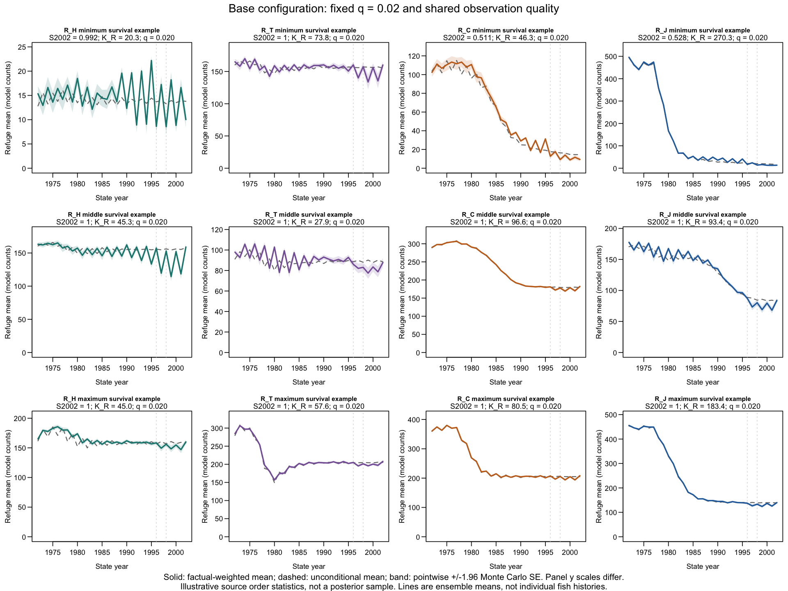
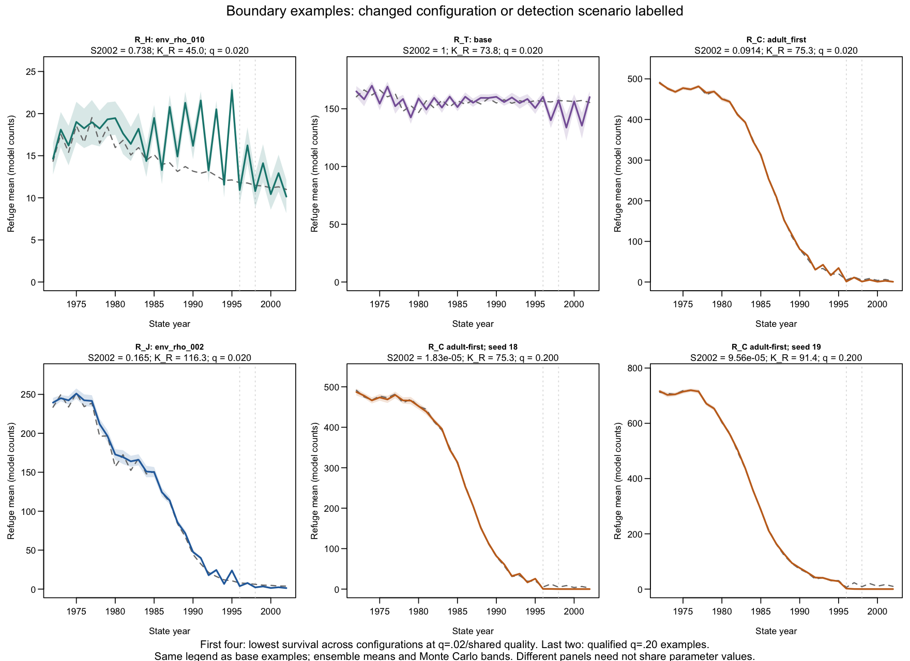
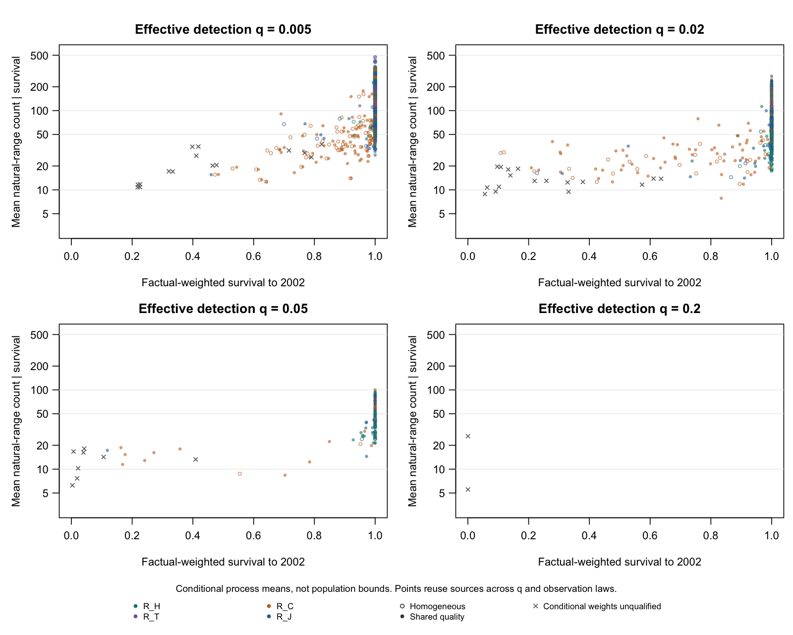
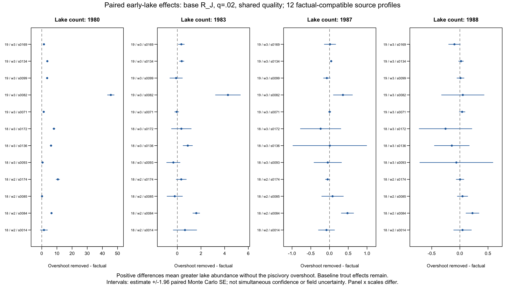

# Ecological interrogation of the frozen common-model results

20 September 2026. Existing-artifact analysis authorised by Barry, before a
further Fable critique. The signed protocol and original compatibility map are
unchanged. No new histories or counterfactual replays were generated.

## Scientific readout

The retained alternatives differ in ecologically consequential ways. Some
compatible ensembles sustain tens to hundreds of model fish through 2002;
others put most factual weight on extinction. Persistence can involve both
lake and refuge compartments. It cannot generally be described as a handful of
fish hidden in a refuge. The record and the assumed observation process still
do not select a unique history.

The trout overshoot has a clearer effect on early lake abundance than on the
terminal outcome. At fixed base configuration, q=.02 and shared observation
quality, removing the overshoot increases mean 1980 lake abundance in all 12
compatible R_J sources; ten paired Monte Carlo intervals exclude zero. The
differences are much smaller by 1987–1988. An early abundance effect can therefore
be obscured by a comparison restricted to survival in 2002. This is a conditional
simulator result, not proof that trout caused the historical loss.

The useful next step is an ecological assessment of what these concrete
persistence histories would require in terms of population scale, distribution
and survey coverage. This analysis does not justify a broad new search or a
new detection cutoff.

## What was interrogated

The [analysis plan](common_model_interrogation_plan.md) specifies an exploratory
description of the existing permissive slice: early-pattern lower95 >= .50,
joint-weight lower95 >= 1e-6, and qualified original joint weights. Those
thresholds do not become independent historical-adequacy standards.

The pool contains 1,527 source/observation profiles from 517 distinct parameter
sources. Sources recur across q values and observation laws. For illustrations,
the fixed base/q=.02/shared-quality comparison selects minimum, middle and
maximum weighted survival within each restriction. Additional cases show the
lowest survival across configurations at that same q and law, and the two
qualified q=.20 R_C profiles. This gives 18 selection roles, 17 distinct
profiles and 25 actual archived replicate examples. All three base R_T choices
tie at survival one, as do the middle and maximum R_H choices; source IDs break
these ties, so their labels do not imply a survival gradient. Eight of the 25
individual examples have poorly concentrated outcome-conditioned weights
(four surviving and four extinct). They remain labelled supported examples,
not typical histories. The selection rule does not rank mechanisms or estimate
posterior probabilities.

R_H has no direct biotic effects; R_T has no direct climbing effects; R_C has
no direct trout effects; R_J permits both. All retain habitat and upsurge
effects and common invader forcing. These are restrictions of one model, not
claims of ecological sufficiency in the absence of habitat change.

## Persistence is not a single ecological narrative

The table reports the lowest-survival illustrative source in each restriction
at **base configuration, q=.02, shared quality**. Means are conditional on
survival through 2002 and on the factual weighting. Counts retain the model's
fish-count interpretation but have not been calibrated to historical abundance.

| Restriction | Weighted survival to 2002 | Refuge mean given survival | Lake mean given survival | Total mean given survival | Survivor-weight ESS |
|---|---:|---:|---:|---:|---:|
| R_H | .9921 | 10.10 | 11.85 | 21.95 | 106.0 |
| R_T | 1.0000 | 160.11 | 40.16 | 200.28 | 178.9 |
| R_C | .5111 | 18.27 | 1.94 | 20.21 | 151.6 |
| R_J | .5281 | 25.32 | 10.32 | 35.64 | 124.2 |

These four examples meet both original and survivor-conditioned precision
criteria. They are illustrative sources, not averages over the restriction.
The middle and maximum-survival examples show further persistence alternatives:
for example, the selected middle R_H source has a total endpoint mean of 205.81,
including 159.03 in the refuge. Its K_R is 45.34. Thus K_R is not a hard ceiling
on realised abundance; the capacity strata in the original map cannot be read
as actual population-size strata.

The curves are source-level annual refuge **ensemble means**, not individual
fish-population trajectories. Solid lines use factual weights, dashed lines
are unconditional means, and bands show pointwise Monte Carlo uncertainty in
the weighted means. Different panels need not share parameter values or axes.

A change in configuration can expose additional histories. The selected
R_H/environmental-variance source (`20260919|env_rho_010|R_H|w2|s0080`) has
weighted survival .73815, leaving .26185 of its factual weight on terminally
extinct histories despite having no direct climbing or trout effects. Its
largest-weight surviving replicate has natural-range totals 38, 9, 40, 3, 36
and 8 in actual state years 1997–2002. Its largest-weight extinct replicate is
already absent in 1996. These are two stochastic realisations from one source,
not two different causal models. The extinct subset has ESS 14.45, so that
particular example illustrates possibility and does not provide a precise
description of the whole extinct subset. Neither example is labelled typical.

The strongest loss examples selected at q=.02 under shared quality are R_C
with minimum dated adult-first removals (survival .09137) and R_J with
environmental variance (survival .16495). Their survivor-conditioned weights
fall short of the declared precision criteria. At q=.20 the two qualified
R_C/removal profiles have weighted survival about 1.83e-5 and 9.56e-5, but
survivor-conditioned ESS only 13.65 and 1.78. Their joint-weight profiles are
qualified and their survival point estimates remain near zero, but the survival
estimates themselves have MC SEs of about 5.0e-6 and 7.2e-5 respectively. The
second therefore has substantial relative uncertainty. Population sizes within
those rare surviving tails are poorer estimates still. Joint-weight
qualification does not guarantee precise estimation of every endpoint.

## Population distributions and their limits

The analysis recovers natural-range counts at actual years 1997–2001 from the
1998–2002 survey-proxy fields, plus the actual 2002 endpoint. It reports
weighted process quantiles and means conditional on terminal survival.
Quantile spread describes stochastic variation; it is not a confidence interval
for historical abundance or a Monte Carlo interval on a mean.

At the endpoint only, E_w(N_refuge | survival) equals E_w(N_refuge) divided by
P_w(survival), because endpoint refuge abundance is zero in every extinct
history. Subtraction from the conditional total gives the lake mean. This
identity was not applied to earlier refuge states: a fish can be present before
an eventual extinction. The archived summaries do not supply the covariance
needed to estimate a new Monte Carlo SE for this conditional refuge mean.

Of 1,527 profiles, 1,485 also meet the weight-concentration criteria after
conditioning on survival; 42 do not. The figure marks those 42 separately.
The exported unfiltered envelope table retains all profiles, with qualification
counts and minimum ESS. Its extrema are exploratory: the independent check
found that unqualified profiles determine 96 minima and 18 maxima among 738
scenario/year rows. In particular, the q=.20 envelope has no qualified
survivor-conditioned profile. Do not quote its extrema as reliable population
bounds, and do not interpret ranges across q as an empirically calibrated
population interval.

Barry's judgment that 50–100 fish might have escaped inconsistent coverage is
relevant ecological context. It is not a hard maximum or a measured detection
probability. Existing capture totals and uncertain historical population
estimates likewise do not fix abundance or effective q: the
[evidence follow-up](terminal_history_evidence_followup.md) documents missing
trip-level effort, possible recaptures, and unclear population-estimate scope.
Small homogeneous q also need not represent persistent spatial blind spots
or correlated coverage adequately. Those are observation-model questions
that this descriptive analysis leaves open.

## Early lake effects of removing the trout overshoot

The paired archive contains 254 final R_J sources with 1,024 matched replicate
streams each. Removing the overshoot leaves baseline trout forcing and effects
in place. Contrasts use unchanged factual joint weights; no altered likelihood
or source reselection enters the analysis. The archive supports lake endpoints
1980, 1983, 1987 and 1988, not a full annual 1978–1990 trajectory. The latter
two years are the actual states behind the 1988/1989 record proxies.

For the 12 compatible **base/q=.02/shared-quality** sources, the paired
difference is altered minus factual model abundance:

| Endpoint | Range of paired mean differences | Intervals wholly above zero | Intervals wholly below zero |
|---|---:|---:|---:|
| Lake 1980 | +0.182 to +45.565 | 10/12 | 0/12 |
| Lake 1983 | -0.338 to +4.277 | 5/12 | 0/12 |
| Lake 1987 | -0.237 to +0.479 | 3/12 | 0/12 |
| Lake 1988 | -0.255 to +0.224 | 1/12 | 0/12 |
| Minimum total, 1972–2002 | -0.317 to +1.088 | 1/12 | 0/12 |

Intervals are sourcewise estimate +/- 1.96 paired Monte Carlo SE. Counts are
descriptions of these sources, not independent votes, simultaneous tests or
mechanism probabilities. Parameter-source variation is distinct from those
Monte Carlo intervals. The whole-period minimum cannot locate an early effect.

For a concrete example, the selected base R_J minimum-survival source
(`20260919|base|R_J|w3|s0082`) has mean 1980 lake abundance 180.38 with the
factual overshoot and 225.95 without it: a difference of 45.56 (MC SE 1.12).
The difference falls to 4.28 in 1983, 0.36 in 1987 and 0.05 in 1988. Its
whole-period minimum-total contrast is 0.012 (MC SE 0.225). Early population
suppression and eventual persistence/loss are therefore distinct questions.

Across configurations and primary observation scenarios, the permissive slice
has 274 R_J source/profiles. Of these, 213 yield defined, precision-qualified
contrasts for each endpoint. The remaining 61 stay undefined because altered
removals become invalid in a history with positive factual support. The rule
is deliberately applied to the whole altered history, including its early
endpoints; tiny or numerically underflowed weights do not evade it. No invalid
history was dropped and no surviving subset of counterfactual weights was
renormalised. The minimum-dated-removal arm still does not test the broader
removal hypothesis, including the 1990–1991 founder collections.

## Consequences for the next scientific step

The equifinality framing remains appropriate, but the alternatives now have
concrete ecological requirements. A useful paper can distinguish what the
observations constrain, which mechanisms affect which phase, and which
apparent conclusions depend on observation or population-scale assumptions.
It cannot yet rank historical causal narratives by probability or regard
failure to find a witness as causal exclusion.

The next substantive assessment should take a small, declared set of these
examples and ask whether their lake/refuge allocations, abundance levels and
late fluctuations are plausible under documented habitat and survey coverage.
That assessment needs explicit empirical grounds for any rejection. It should
separate field evidence from the judgement used to map it to model states.
Only if a consequential distinction depends on missing annual states would a
bounded replay be worth proposing. The early-lake contrasts already answer
the available endpoint question without new simulation.

For conservation interpretation, the present analysis supports examining
actions that remain useful across plausible histories and being explicit about
which mechanism each action assumes. It does not establish climbing effects
as necessary, identify a single cause of loss, or rank interventions. Such
recommendations would require a separate decision-focused analysis.

## Verification and artifacts

The new analysis verified input hashes against the frozen archive and
reproduced original log joint weight, ESS and weighted survival for all 1,527
selected profiles (maximum absolute difference 5.69e-13). The paired readout
verified all 254 x 1,024 source/replicate/seed pairings, the factual weights,
invalid-removal handling and paired Monte Carlo formula. No original production
artifact, protocol, likelihood or compatibility decision changed.

The [independent audit](common_model_interrogation_audit.md) returned
**conditionally supported**, with no mismatches in its bounded checks of the
new estimands, selection, example histories and paired contrasts. Its reporting
corrections about unqualified survivor-conditioned extrema and endpoint precision
are retained above. Machine-readable outputs and receipts are in
[`interrogation_20260920`](../data/common_model/interrogation_20260920/) and
[`early_lake_20260920`](../data/common_model/early_lake_20260920/). Figures also
have standalone PDF versions in the interrogation figure directory. A separate
completion receipt binds this tranche; original production receipts remain
unchanged. Further Fable critique has not been requested in this tranche.
