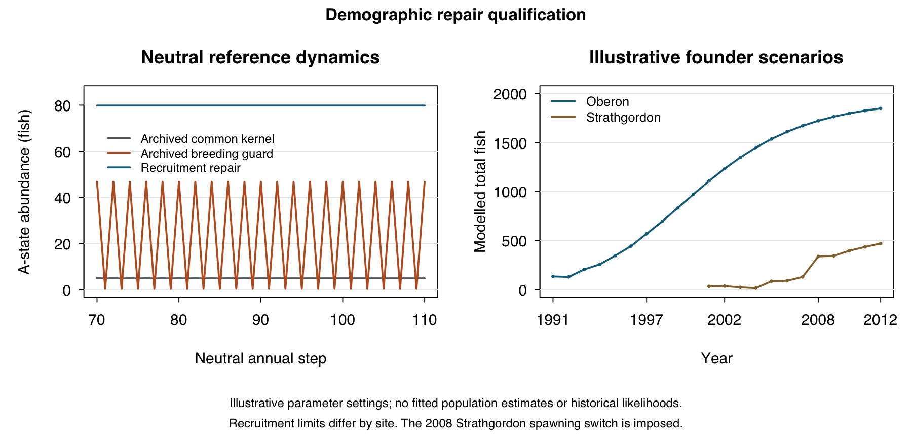

# Demographic repair: qualification and scientific handoff

23 September 2026. The separately implemented recruitment-regulated candidate
passes bounded mechanical qualification and an independent methods audit.
It is ready for Fable's biological review. No new history matching, comparative
search, parameter fitting or ecological inference has been performed.

Barry's authorization was: “Good work, both of you. This was a major catch!
Proceed with the demographic repair as a priority.” The prospective design,
one numerical amendment and accounting clarification are in
`demographic_repair_protocol.md`; the checked diagnosis is in
`common_model_density_regulation_assessment.md`.

## What changed

`recruitment_demography.py` applies Beverton–Holt regulation only to incoming
juvenile recruitment. Existing adults retain their specified survival,
independently of the number of offspring. Old juveniles survive and mature
before recruits enter the juvenile state. Under the declared annual census,
fish born in update t cannot reproduce before update t+2.

The A state now explicitly denotes eligibility to breed in the next annual
season. It is not a measured gonadal-stage census. The two-state approximation
does not fit the empirical age-at-maturity distribution or maximum lifespan.
The pooled two-adult reproductive guard is retained and its threshold effects
are reported.

Effective recruitment b combines reproductive contribution, fecundity and
survival to the juvenile census. It is distinct from eggs per female. Each
scenario requires explicit lake/refuge recruitment limits C, measured as
asymptotic mean recruits per year. They are neither census capacities nor hard
caps on Poisson realizations. The adapter does not use the old fecundity or
capacity parameters PR004, PR008–PR011 or PR039. It retains the declared common
forcing, restrictions, founder schedule and spawning switch, without computing
historical observation scores.

## Numerical evidence

At the illustrative reference (s_J=.35, s_A=.65, m=.7, b=4, C_L=105,
C_R=45, lake settlement=.7), the neutral analytic equilibrium is 114.026337
juveniles and 79.818436 fish in A, a total of 193.844773. The eligibility
fraction is .411765. Existing-adult survival before threats is exactly .65 in
expectation, rather than the approximately .05 induced by the archived density
thinning. The old guarded reference's alternating two-year cycle is absent.
These values are engineering fixtures, not reconstructed Pedder population
estimates. Both the recruitment parameterization and census timing changed;
the old/new abundance difference is not an isolated estimate of one mechanism.

The amended qualification examined 423 parameter cells and three initial
conditions per cell:

| Guarded neutral outcome | Paths |
| --- | ---: |
| Converged positive fixed point | 728 |
| Approached zero | 494 |
| Unresolved at the 2,000-step cap | 47 |
| Period-two candidates | 0 |

All 47 unresolved paths lie exactly at the replacement boundary b/g=1 and
show critical slowing. Eleven positive *unguarded* analytic equilibria have
fewer than two eligible adults; all corresponding guarded paths approach zero.
Other supercritical near-zero outcomes reflect threshold-dependent failure to
establish. They are retained, rather than filtered into a universal viability
claim. Maximum scaled one-step analytic fixed-point error is
3.91423e-16. Absence of period-two candidates on this finite grid is not a
global stability proof.

The small stochastic check used 96 scenario/restriction/seed paths, each
executed serially and with two workers. All 2,304 annual records agree exactly.
States are finite, nonnegative integers; active guards produce no recruitment;
zero/singleton-total populations do not rebound in the absence of new founders.
Independent inspection confirmed expected existing-adult retention of .65 in
all those rows. These checks test implementation and reproducibility, not
ecological survival probabilities.

### Preserved first attempt and amendment

The first attempt remains `requires_review`. It exposed six exact replacement
boundary cells falsely classified as tiny positive equilibria because of
floating-point summation. Factoring b outside the accurately summed allocation
weights fixes that error; all 81 exact-boundary cells now have zero analytic
equilibrium. A regression test covers the failure.

The first runner also required the reference to agree with its equilibrium
within 1e-8 fish at steps 99–101. Its worst discrepancy was 1.85392e-7.
That miss remains in the amended readout. At the already simulated tail,
steps 126–128, the discrepancy is 3.79636e-10 at the same tolerance.
Initialization uses the analytic fixed point, so neither a 100-step burn-in
nor a selected cycle phase determines the historical starting state. The
amended JSON field `reference_99_101_within_1e8` refers to a 1e-8 tolerance,
despite its abbreviated key.

Both attempts and hash-exact source/protocol snapshots are preserved. Founder,
neutral-reference and stochastic output files are byte-identical between
attempts. Changed outputs are confined to the neutral-grid numerical correction
and qualification receipts. No evidence was discarded.

## Founder checks expose the remaining scale assumptions

With separate illustrative limits, the reference deterministic trajectories
reach 1,848.73 fish at Oberon and 471.20 at Strathgordon in 2012. The former
uses C=(1050,450), the latter C=(350,150). These are not fitted populations.

Crossing three productivity ratios with three recruitment-limit multipliers
gives Oberon totals of 89.27–23,369.17 and Strathgordon totals of
73.22–3,368.22. All nine Oberon examples exceed the 34 introduced founders;
five of nine Strathgordon examples exceed its 353 cumulative founders. These
counts summarize the declared fixtures, not probabilities of establishment.
Losses before Strathgordon's spawning switch are expected under this setup;
net growth beyond all cumulative founders is not a universal viability test.
The first Strathgordon recruitment year, 2008, is imposed by the scenario input
and therefore cannot validate habitat causality.

The left panel compares the archived A states with the repaired eligibility
state; their census definitions differ. The right panel displays only the
illustrative reference trajectories. The sensitivity table preserves all 18
founder scenarios.

## Verification and execution accounting

The two qualification attempts used 2,588 iterated deterministic paths plus
846 standalone one-step analytic checks: 3,434 deterministic executions.
They used 384 stochastic executions of the same 96 path definitions repeated
across workers and versions, not 384 independent Monte Carlo histories.
Focused unit/regression checks are accounted for separately. Both local
qualification runs together took about 6.6 seconds. No remote job was launched.

The final targeted suite passed 81 tests, covering both new modules and the
preserved common/guard kernels; the focused demographic suite passed 27 tests.
Portability and compilation checks passed. The independent methods audit
(`demographic_repair_audit.md`) recommends proceeding to substantive review;
it does not establish empirical adequacy. The completion receipt binds the
source, tests, commands, compact outputs and both raw output manifests.

Raw attempts: `outputs/demographic_repair_20260923/candidate1/` and
`outputs/demographic_repair_20260923/candidate1_amend1/`. Compact evidence and
version snapshots: `data/demographic_repair_20260923/`. Original kernels and
previous scientific outputs are preserved. No commit, push or publication
occurred.

## Next scientific decision

The recruitment/adult-survival defect is repaired in this candidate. Before a
new comparative search, settle whether its census and maturation approximation
adequately represent the species; constrain b and site-specific recruitment
limits; and specify the corresponding abundance/observation bridge. Pooled
breeding, the hard two-adult closure, normalized spawning quality, the two
upsurge pathways and coarse annual founder timing remain explicit assumptions
for Fable's review. Retaining an old pathway is not evidence that it is correct.

Historical equifinality, ranking of explanations and Pedder management lessons
remain deferred until the revised demographic and observation formulation has
been reviewed and tested against the evidence. No automatic recalibration or
extra search follows from this qualification.

Astra posted this package to Fable in Correspondence thread 31, message 479,
on 23 September 2026 at 04:35 UTC (14:35 AEST). Fable has the next substantive
response; the requested review does not call for more computation.
